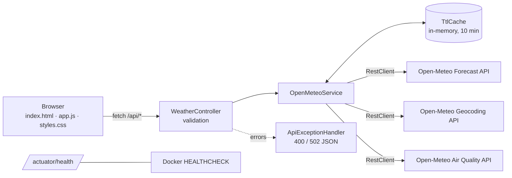
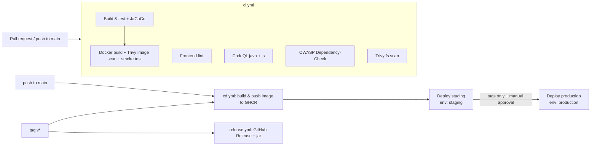

# 🌦️ Weather Forecasting App

[](https://github.com/shubhamkhedkar/weather-forecast-app/actions/workflows/ci.yml)
[](https://github.com/shubhamkhedkar/weather-forecast-app/actions/workflows/cd.yml)
[](https://github.com/shubhamkhedkar/weather-forecast-app/actions/workflows/release.yml)


[](LICENSE)

A **Java 17 / Spring Boot** backend with a lightweight **HTML/CSS/JavaScript** frontend that shows live weather,
hourly & 7‑day forecasts and air quality for any city, powered by the free **[Open-Meteo](https://open-meteo.com/)** APIs (no API key needed).

> ℹ️ GitHub Actions is currently **disabled** on this repository. The CI/CD pipeline is committed and ready, but nothing runs or deploys until Actions is enabled.

---

## Table of contents
- [Features](#features) · [Architecture](#architecture) · [Tech stack](#tech-stack) · [Data sources](#data-sources)
- [API](#api-endpoints) · [Project structure](#project-structure) · [Run locally](#run-locally) · [Docker](#docker)
- [Tests & coverage](#tests--coverage) · [CI/CD](#cicd-pipeline) · [Secrets & environments](#required-secrets--environments)
- [Troubleshooting](#troubleshooting) · [License](#license)

## Features
- 🔎 City search with live suggestions (Open-Meteo Geocoding)
- 📍 "Use my location" via browser geolocation
- 🌡️ Current conditions: temperature, feels-like, humidity, wind speed/direction/gusts, precipitation, UV index, pressure, cloud cover, sunrise/sunset
- 📈 48-hour hourly chart (Chart.js) + hourly strip, 🗓️ 7-day daily cards
- 🌫️ Air quality: US & European AQI, PM2.5, PM10, O₃, NO₂, SO₂, CO
- °C/°F toggle, WMO weather-code icons, recent searches (localStorage), responsive layout
- ⚡ Server-side in-memory TTL cache (10 min default) to reduce upstream calls
- ✅ Input validation (400) and upstream error mapping (502) with JSON error bodies
- ❤️ Spring Boot Actuator health endpoint used by Docker `HEALTHCHECK`

## Architecture


The static frontend is served by Spring Boot from `src/main/resources/static`, so the whole app ships as one jar / one container.

## Tech stack
| Layer | Technology |
|---|---|
| Backend | Java 17, Spring Boot 3.3.5 (Web, Validation, Actuator) |
| Frontend | Vanilla HTML/CSS/JS, Chart.js (CDN) |
| Build | Maven (wrapper `./mvnw`), JaCoCo |
| Tests | JUnit 5, MockMvc, MockRestServiceServer |
| Lint | ESLint, Stylelint, HTMLHint (via `package.json`) |
| Container | Docker multi-stage (Temurin 17 JDK → JRE), non-root user |
| CI/CD | GitHub Actions, CodeQL, OWASP Dependency-Check, Trivy, GHCR, Dependabot |

## Data sources
| Data | API |
|---|---|
| Forecast | https://api.open-meteo.com/v1/forecast |
| Geocoding | https://geocoding-api.open-meteo.com/v1/search |
| Air quality | https://air-quality-api.open-meteo.com/v1/air-quality |

**Attribution:** Weather data by [Open-Meteo.com](https://open-meteo.com/), licensed under [CC BY 4.0](https://creativecommons.org/licenses/by/4.0/).
Free for non-commercial use; see Open-Meteo's terms for commercial usage.

## API endpoints
| Method | Path | Params | Description |
|---|---|---|---|
| GET | `/api/search` | `q` (2–100 chars) | Geocode a city name |
| GET | `/api/forecast` | `lat` (-90..90), `lon` (-180..180) | Current, hourly and daily forecast |
| GET | `/api/air-quality` | `lat`, `lon` | Current/hourly air-quality data |
| GET | `/actuator/health` | – | Liveness/health (`{"status":"UP"}`) |
| GET | `/` | – | Frontend UI |

Examples:
```bash
curl "http://localhost:8080/api/search?q=Pune"
curl "http://localhost:8080/api/forecast?lat=18.52&lon=73.86"
curl "http://localhost:8080/api/air-quality?lat=18.52&lon=73.86"
curl "http://localhost:8080/actuator/health"
```
Errors are JSON: `{"status":400,"error":"..."}` for invalid input, `{"status":502,"error":"..."}` when Open-Meteo fails.

### Configuration (`application.properties`)
| Property | Env var | Default |
|---|---|---|
| `server.port` | `PORT` | `8080` |
| `cache.ttl-seconds` | `CACHE_TTL_SECONDS` | `600` |
| `openmeteo.forecast-url` / `geocoding-url` / `air-quality-url` | `OPENMETEO_*` | Open-Meteo public URLs |

## Project structure
```
weather-forecast-app/
├── .github/
│   ├── workflows/          # ci.yml, cd.yml, release.yml, README.md
│   ├── dependabot.yml
│   ├── CODEOWNERS
│   └── PULL_REQUEST_TEMPLATE.md
├── docs/CI-CD.md           # detailed pipeline docs
├── src/main/java/com/example/weather/
│   ├── WeatherApplication.java
│   ├── WeatherController.java     # REST endpoints + validation
│   ├── OpenMeteoService.java      # upstream calls + caching
│   ├── TtlCache.java              # simple TTL cache
│   ├── ApiExceptionHandler.java   # 400/502 JSON errors
│   └── UpstreamException.java
├── src/main/resources/
│   ├── application.properties
│   └── static/ (index.html, app.js, styles.css)
├── src/test/java/...              # 10 JUnit tests
├── Dockerfile · .dockerignore · docker-compose.yml
├── pom.xml · mvnw · package.json · eslint.config.js · .stylelintrc.json · .htmlhintrc
└── LICENSE
```

## Run locally
Prerequisites: JDK 17+ (Node 20+ only for linting).
```bash
./mvnw spring-boot:run          # http://localhost:8080
# or
./mvnw package && java -jar target/weather-forecast-app-1.0.0.jar
```

## Docker
```bash
docker build -t weather-forecast-app .
docker run -p 8080:8080 weather-forecast-app
# or
docker compose up --build
docker inspect --format '{{.State.Health.Status}}' <container>   # healthy
```
Published images (once CD is enabled): `ghcr.io/shubhamkhedkar/weather-forecast-app:<tag>`.

## Tests & coverage
```bash
./mvnw verify                    # 10 tests + JaCoCo report
open target/site/jacoco/index.html
npm ci && npm run lint           # ESLint + Stylelint + HTMLHint
```

## CI/CD pipeline

- **CI** runs on every PR/push to `main`; images are built but never pushed.
- **CD** publishes images to GHCR, then promotes through `staging` → `production`. Deploy steps are **commented placeholders** (kubectl / SSH examples) — no real infrastructure is targeted.
- **Release** creates a GitHub Release with the jar, SHA256 checksums and auto-generated notes for tags `v*`.
- **Dependabot** keeps Maven, npm, GitHub Actions and Docker base images up to date.

See [docs/CI-CD.md](docs/CI-CD.md) for job-by-job details.

## Required secrets & environments
| Name | Type | Used by | Required? |
|---|---|---|---|
| `GITHUB_TOKEN` | automatic | GHCR push, releases, SARIF upload | auto |
| `NVD_API_KEY` | secret | OWASP Dependency-Check (faster NVD downloads) | recommended |
| `KUBE_CONFIG_STAGING` / `KUBE_CONFIG_PRODUCTION` | secret | example kubectl deploy | only if you use it |
| `STAGING_SSH_KEY`, `STAGING_HOST`, `PROD_SSH_KEY`, `PROD_HOST` | secret | example SSH deploy | only if you use it |
| `STAGING_URL`, `PRODUCTION_URL` | variable | environment URLs / smoke tests | optional |

Setup:
1. **Settings → Actions → General**: enable Actions; set *Workflow permissions* to "Read and write" (or rely on per-job `permissions`).
2. **Settings → Environments**: create `staging` and `production`; on `production` add *Required reviewers* (manual approval) and restrict to tags `v*`.
3. **Settings → Code security**: enable Dependabot alerts and code scanning (for CodeQL/Trivy SARIF).
4. Replace the placeholder deploy steps in `cd.yml` with your real commands.

## Troubleshooting
| Problem | Fix |
|---|---|
| `./mvnw: Permission denied` | `chmod +x mvnw` |
| Port 8080 in use | `PORT=9090 ./mvnw spring-boot:run` |
| 502 from `/api/*` | Open-Meteo unreachable / rate-limited; check network or proxy |
| "Use my location" fails | Geolocation needs HTTPS or `localhost` and browser permission |
| Chart not visible | Chart.js loads from CDN — check internet / CSP |
| Container `unhealthy` | `docker logs <id>`; verify `/actuator/health` responds |
| Dependency-Check slow/failing | Add `NVD_API_KEY` secret |
| Workflows not running | Actions is disabled on this repo — enable it in Settings |

## License
[MIT](LICENSE) © Shubham Khedkar. Weather data © Open-Meteo.com (CC BY 4.0).
