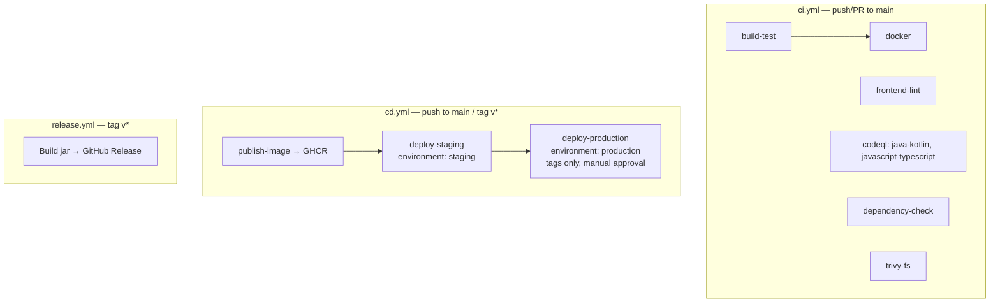

# CI/CD Pipeline — Detailed Guide

> **Status:** GitHub Actions is **disabled** on `shubhamkhedkar/weather-forecast-app`. The workflows below are committed but will not run (and nothing will be deployed) until Actions is enabled in *Settings → Actions → General*.

## Overview


## 1. `ci.yml` — Continuous Integration
Triggers: `push` and `pull_request` on `main`, plus `workflow_dispatch`. Default token permission is `contents: read`; jobs elevate only what they need. `concurrency` cancels superseded runs on the same ref.

| Job | Purpose | Key details | Artifacts / outputs |
|---|---|---|---|
| **build-test** | Compile, run 10 JUnit tests, generate coverage | `actions/setup-java@v4` (Temurin 17, Maven cache) → `./mvnw -B -ntp verify` (JaCoCo `prepare-agent` + `report`). Writes line-coverage % to the job summary. | `surefire-reports`, `jacoco-report`, `app-jar` |
| **frontend-lint** | Lint static frontend | Node 20, `npm ci`, then `lint:js` (ESLint 9 flat config, browser globals + `Chart`), `lint:css` (Stylelint standard), `lint:html` (HTMLHint) | – |
| **codeql** | SAST | Matrix `java-kotlin` & `javascript-typescript`, `security-and-quality` queries; Java built with `./mvnw package -DskipTests`. Needs `security-events: write`. | Code scanning alerts |
| **dependency-check** | SCA for Maven deps | `org.owasp:dependency-check-maven:10.0.4:check`, fails at CVSS ≥ 9 (job is `continue-on-error` so NVD outages don't block). Uses `NVD_API_KEY` secret if present. | `dependency-check-report` (HTML + SARIF) |
| **trivy-fs** | Repo scan | `aquasecurity/trivy-action` fs scan for vulns, secrets, misconfig (CRITICAL/HIGH) → SARIF uploaded to code scanning | Code scanning alerts |
| **docker** | Image build + scan + smoke test | `needs: build-test`. Buildx with GHA cache, `push: false`, `load: true`. Trivy image scan (ignore-unfixed, CRITICAL/HIGH) → SARIF. Runs the container and polls `/actuator/health`. | Code scanning alerts |

## 2. `cd.yml` — Continuous Delivery
Triggers: push to `main`, tags `v*`, manual. `concurrency` without cancellation so deployments never get interrupted.

### publish-image
- Re-runs `./mvnw verify` (never publish untested code).
- QEMU + Buildx → multi-arch (`linux/amd64`, `linux/arm64`) image.
- Logs in to GHCR with the built-in `GITHUB_TOKEN` (`packages: write`).
- `docker/metadata-action` tags: branch name, semver `X.Y.Z` and `X.Y`, short SHA, `latest` on default branch.
- Generates SBOM + provenance attestations. Outputs image `digest` and `version`.

Image: `ghcr.io/shubhamkhedkar/weather-forecast-app`

### deploy-staging
- `environment: staging` (URL from `vars.STAGING_URL`). Add protection rules in *Settings → Environments* if wanted.
- Deploys by immutable digest. **Placeholder only** — prints what it would do; commented examples for `kubectl set image` + `rollout status` and SSH + `docker compose`.
- Placeholder smoke test against `/actuator/health`.

### deploy-production
- Runs only for tags `v*` and after staging succeeds.
- `environment: production` — configure **Required reviewers** so it waits for manual approval.
- Same placeholder deploy/smoke-test pattern.

## 3. `release.yml` — Releases
Trigger: tags `v*`. Builds with `./mvnw verify`, copies the jar to `dist/weather-forecast-app-<tag>.jar`, writes `SHA256SUMS.txt`, and creates a GitHub Release via `softprops/action-gh-release@v2` with `generate_release_notes: true`. Tags containing `-` (e.g. `v1.1.0-rc.1`) are marked pre-release. Needs `contents: write`.

```bash
git tag v1.0.0
git push origin v1.0.0   # → release.yml + cd.yml (staging → production approval)
```

## 4. Dependabot (`.github/dependabot.yml`)
Weekly (Monday) updates for `maven` (Spring grouped), `npm` (lint tooling grouped), `github-actions` (grouped) and `docker` (base images in `Dockerfile`).

## 5. Repo hygiene
- `CODEOWNERS`: `* @shubhamkhedkar` — auto-requests review.
- `PULL_REQUEST_TEMPLATE.md`: summary, change type, checklist (verify, lint, tests, docs, no secrets).
- Recommended branch protection on `main`: require PR + passing checks `Build & Test (Java 17)`, `Frontend Lint …`, `CodeQL (...)`, `Docker build & Trivy image scan`.

## 6. Secrets, variables & environments
| Name | Kind | Where | Notes |
|---|---|---|---|
| `GITHUB_TOKEN` | auto | all | GHCR push, releases, SARIF |
| `NVD_API_KEY` | repo secret | ci.yml | https://nvd.nist.gov/developers/request-an-api-key |
| `KUBE_CONFIG_STAGING` / `KUBE_CONFIG_PRODUCTION` | env secret | cd.yml (example) | base64 kubeconfig |
| `STAGING_SSH_KEY`, `STAGING_HOST`, `PROD_SSH_KEY`, `PROD_HOST` | env secret | cd.yml (example) | SSH deploy |
| `STAGING_URL`, `PRODUCTION_URL` | env variable | cd.yml | environment URL & smoke test |

## 7. Running the same checks locally
```bash
./mvnw verify                                   # tests + coverage (target/site/jacoco)
npm ci && npm run lint                          # frontend lint
docker build -t weather-forecast-app . && docker run -p 8080:8080 weather-forecast-app
trivy fs .                                      # if Trivy installed
actionlint                                      # validate workflows
```

## 8. Enabling the pipeline later
1. Enable Actions (Settings → Actions → General).
2. Create `staging` and `production` environments (production: required reviewers, tag-only deployment branch rule).
3. Add secrets above as needed.
4. Replace placeholder deploy steps in `cd.yml` with real commands.
